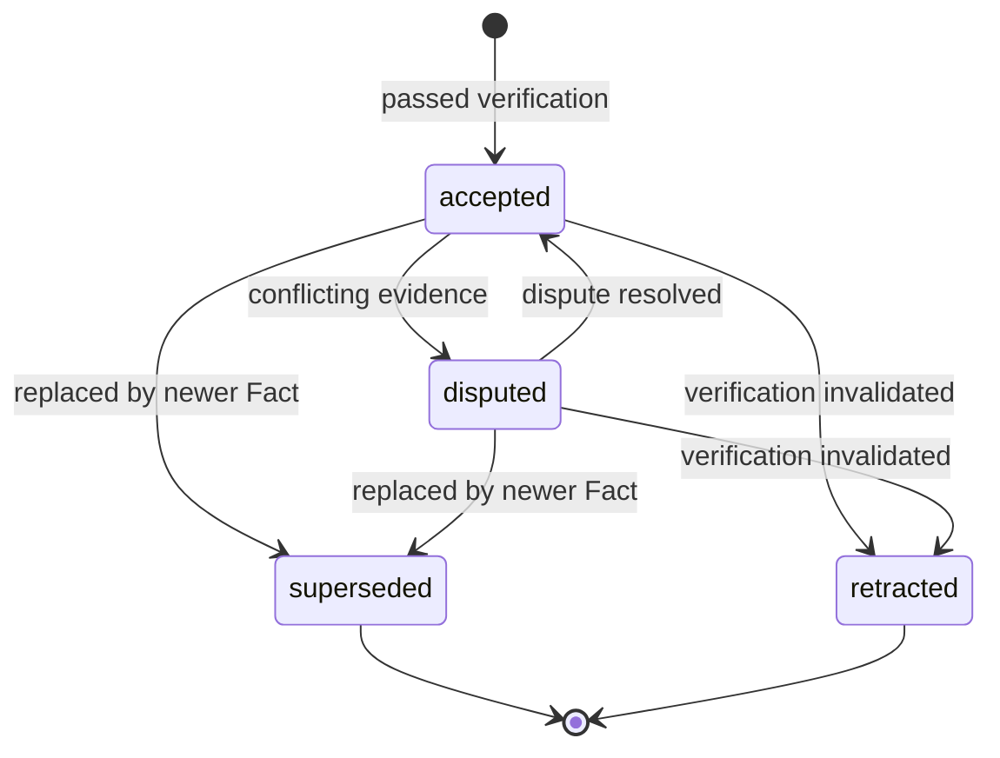
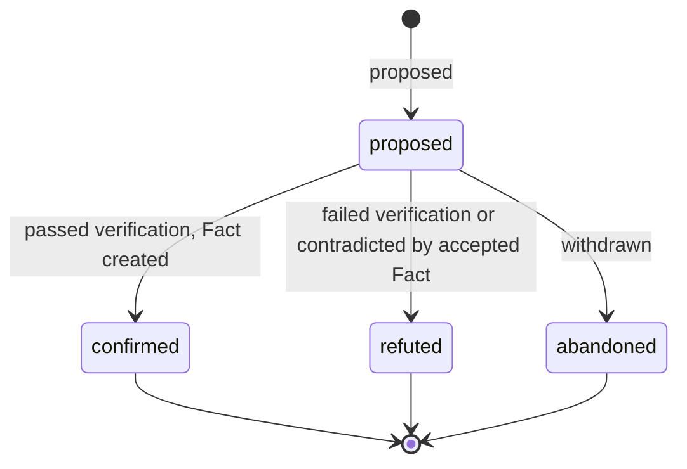
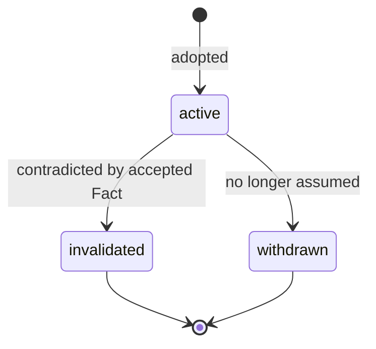

# Reasoning Entities

This document defines three knowledge entities and the rules that connect them.

| Entity | In one line | Can it become a Fact? |
|---|---|---|
| **Fact** | A verified, immutable proposition backed by evidence | — |
| **Hypothesis** | An unverified proposition that is being evaluated and is used to evaluate a Premise | Yes |
| **Premise** | A proposition assumed true for a line of reasoning | No |

All three hold a single proposition in `statement`. They differ in **why** the system treats that proposition as usable:

- A Fact is usable because it has been verified and we can come to a conclusion using it and decide on the next action of the system.
- A Hypothesis is not usable as truth. It is being tested.
- A Premise is usable because someone chose to assume it or is true to a subjected reality.

Shared conventions:

- `scope` is the non-temporal context in which a proposition holds, such as system, environment or jurisdiction. Time is kept in separate validity fields.
- Every state change is recorded as a Trace event. Trace is defined elsewhere.

---

# Entity: Facts

## Summary

A Fact is a proposition that the system accepts as true because it passed a Verification under a Verification Policy.

Facts are immutable. Only `status` can change, and it can change only through the actions listed below. To correct a Fact, create a superseding Fact.

A Fact holds only within its `scope` and validity period. A high confidence score never makes something a Fact. Only a passed Verification does.

## Schemas

**Fact**

| Field | Type | Description |
|---|---|---|
| id | Unique ID | Unique identifier |
| subject | Reference or Text | What the Fact is about |
| statement | Text | The proposition |
| fact_type | Category | `observed` (internal observation or measurement) or `external` (asserted by an external source) |
| scope | Struct | Context in which the Fact holds |
| sensitivity | Category | Access classification |
| valid_from | DateTime | Start of validity in the world |
| valid_until | DateTime / Null | End of validity in the world. Null means open-ended |
| evidence_ids | List of references to Evidence | Supporting evidence. Must not be empty |
| verification_id | Reference to Verification | The passed Verification that established the Fact |
| hypothesis_id | Reference to Hypothesis / Null | Hypothesis this Fact was promoted from, if any |
| supersedes_id | Reference to Fact / Null | Fact this one replaces, if any |
| status | Category | `accepted`, `disputed`, `superseded`, `retracted` |
| created_at | DateTime | When the Fact was recorded. This is distinct from `valid_from` |
| created_by | Reference to User / Agent / System | Actor who established it |

**Evidence**

| Field | Type | Description |
|---|---|---|
| id | Unique ID | Unique identifier |
| source_id | Reference to Source | Where it came from |
| evidence_type | Category | `document`, `observation`, `measurement`, `record`, `test_result`, `external_assertion` |
| content | Struct / Text | The evidence itself |
| observed_at | DateTime / Null | When the evidence was produced |
| collected_at | DateTime | When the system received it |
| collected_by | Reference to User / Agent / System | Actor who collected it |
| metadata | Struct | Source-specific extras |

**Source**

| Field | Type | Description |
|---|---|---|
| id | Unique ID | Unique identifier |
| source_type | Category | `RAG`, `LLM`, `external`, `human` |
| name | Text | Display name |
| reliability | Number / Null | Assessed reliability, 0–1 |
| uri | URL / Null | Location of the original source |

**Verification**

| Field | Type | Description |
|---|---|---|
| id | Unique ID | Unique identifier |
| target_id | Reference to Hypothesis or Fact | What is being verified |
| policy_id | Reference to Verification Policy | Policy applied |
| policy_version | Number | Exact policy version applied |
| verification_type | Category | `automated`, `manual`, `external`, `experimental` |
| evidence_ids | List of references to Evidence | Evidence evaluated |
| result | Category | `passed`, `failed` (evidence contradicts the claim), `inconclusive` (policy not satisfied) |
| confidence | Number | Confidence of the result, 0–1 |
| verified_at | DateTime | When it ran |
| verified_by | Reference to User / Agent / System | Actor or system that ran it |

**Verification Policy**

Each version of a policy is an immutable record. The key is (`id`, `version`).

| Field | Type | Description |
|---|---|---|
| id | Unique ID | Policy identifier, shared across versions |
| version | Number | Version number |
| name | Text | Display name |
| allowed_verification_types | List of Categories | Verification types that may satisfy the policy |
| required_evidence_types | List of Categories | Evidence types that must be present |
| minimum_source_count | Number | Minimum number of distinct `source_id`s across the evidence |
| minimum_authority | Category | Lowest Source authority that counts toward the source count |
| minimum_confidence | Number / Null | Minimum Verification confidence, if any |

## Lifecycle

**Fact**

| State | Description |
|---|---|
| accepted | Verified and available for reasoning |
| disputed | Challenged. Kept for audit, but excluded from reasoning unless the caller explicitly allows it |
| superseded | Replaced by a newer Fact. Terminal state |
| retracted | Shown to be invalid because of bad evidence, a bad source or a bad verification. Terminal state |

**Rules**

- A Fact MUST reference a passed Verification and at least one Evidence record.
- A Fact MUST NOT be created from an internal inference alone, whatever its confidence.
- All fields except `status` are immutable. `status` changes only through the actions below.
- Evidence is immutable.
- A superseding Fact MUST set `supersedes_id`, and the old Fact moves to `superseded`.
- A Verification is bound to a policy version. A new policy version MUST NOT change past results.
- Validity time (`valid_from` / `valid_until`) and recording time (`created_at`) are separate and MUST NOT be confused.

## Actions

| Action | Resource | Operation | Reversible | Description |
|---|---|---|---|---|
| create_fact | fact | create | No | Verify evidence and create the Fact together in one atomic step |
| retrieve_fact | fact | read | N/A | Read a Fact with its evidence and verification |
| dispute_fact | fact | alter | Yes | Move an accepted Fact to `disputed` |
| resolve_fact_dispute | fact | alter | Yes | Move a disputed Fact back to `accepted` |
| supersede_fact | fact | create | No | Create a replacement Fact and mark the old one `superseded` |
| retract_fact | fact | alter | No | Move a Fact to `retracted` |
| create_source | source | create | No | Register a Source |
| create_evidence | evidence | create | No | Register Evidence |
| verify | verification | create | No | Run a Verification against a Hypothesis or Fact |
| create_verification_policy | verification_policy | create | No | Create version 1 of a policy |
| alter_verification_policy | verification_policy | create | No | Create the next version of a policy |

## Relationships

| Entity | Cardinality | Direction | Description |
|---|---|---|---|
| Evidence | Many-to-many | Fact <-> Evidence | Evidence supports Facts |
| Source | Many-to-one | Evidence -> Source | Each Evidence record has one Source |
| Verification | Many-to-one | Fact -> Verification | The Verification that established the Fact |
| Verification Policy | Many-to-one | Verification -> Verification Policy | Policy version applied |
| Fact | One-to-one (self) | Fact -> Fact | A Fact may supersede one earlier Fact |
| Hypothesis | Many-to-one | Fact -> Hypothesis | A Fact may be promoted from a Hypothesis |
| Hypothesis | Many-to-many | Fact <-> Hypothesis | Facts support or contradict Hypotheses |
| Premise | One-to-many | Fact -> Premise | A Fact may invalidate Premises |
| Inference | One-to-many | Fact -> Inference | Facts are inputs to Inferences |
| Decision | Many-to-many | Fact <-> Decision | Facts are part of the evidential basis for Decisions |
| Trace | One-to-many | Fact -> Trace | Audit of every state change |

---

# Entity: Hypotheses

## Summary

A Hypothesis is a single proposition that has not been verified yet. The system tests it by linking Facts that support or contradict it, and it may run a Verification on it.

A Hypothesis may carry an internal `confidence`, but that score only ranks hypotheses. It never verifies one.

A Hypothesis becomes a Fact only through `promote_hypothesis`, which requires a passed Verification.

## Schemas

**Hypothesis**

| Field | Type | Description |
|---|---|---|
| id | Unique ID | Unique identifier |
| subject | Reference or Text | What the Hypothesis is about |
| statement | Text | The proposition. Immutable |
| scope | Struct | Context in which it would hold |
| sensitivity | Category | Access classification |
| confidence | Number / Null | Current internal estimate, 0–1. Used for ranking, not for verification |
| supporting_fact_ids | List of references to Fact | Facts that support it |
| contradicting_fact_ids | List of references to Fact | Facts that contradict it |
| fact_id | Reference to Fact / Null | The Fact created when it was confirmed |
| status | Category | `proposed`, `confirmed`, `refuted`, `abandoned` |
| created_at | DateTime | Creation timestamp |
| created_by | Reference to User / Agent / System | Who proposed it |

## Lifecycle

| State | Description |
|---|---|
| proposed | Open and being evaluated |
| confirmed | Promoted to a Fact. From here on the Fact carries the truth status |
| refuted | Shown false. Terminal state |
| abandoned | No longer pursued. Terminal state |

**Rules**

- `statement` and `scope` are immutable. To change the claim, propose a new Hypothesis.
- An `inconclusive` Verification leaves the Hypothesis `proposed`.
- A conclusion that depends on a Hypothesis is conditional and MUST NOT be stored as a Fact.

## Actions

| Action | Resource | Operation | Reversible | Description |
|---|---|---|---|---|
| propose_hypothesis | hypothesis | create | No | Create a Hypothesis in `proposed` |
| link_fact | hypothesis | alter | Yes | Add a Fact as supporting or contradicting evidence |
| update_confidence | hypothesis | alter | Yes | Change the internal confidence estimate |
| promote_hypothesis | fact | create | No | Create a Fact from a passed Verification and set the Hypothesis to `confirmed` |
| refute_hypothesis | hypothesis | alter | No | Move to `refuted` |
| abandon_hypothesis | hypothesis | alter | No | Move to `abandoned` |

## Attributes (ABAC)

| Entity | Attribute | Description |
|---|---|---|
| Hypothesis | sensitivity | Access classification |

## Relationships

| Entity | Cardinality | Direction | Description |
|---|---|---|---|
| Fact | Many-to-many | Hypothesis <-> Fact | Supporting and contradicting Facts |
| Fact | One-to-one | Hypothesis -> Fact | The Fact it became, if confirmed |
| Verification | One-to-many | Hypothesis -> Verification | Verification attempts |
| Trace | One-to-many | Hypothesis -> Trace | Audit of every entity transition |

---

# Entity: Premises

## Summary

A Premise is a proposition that a line of reasoning assumes to be true. It is stipulated, not verified. Examples are a scenario assumption, a planning constraint, or a "what if".

A Premise is valid only for the reasoning that uses it. Each Inference or Decision lists the Premises it depends on, so the set of premises a conclusion rests on is always visible.

A Premise never becomes a Fact. To establish it as true, propose it as a Hypothesis and verify it.

## Schemas

**Premise**

| Field | Type | Description |
|---|---|---|
| id | Unique ID | Unique identifier |
| statement | Text | The assumed proposition. Immutable |
| scope | Struct | Context in which it is assumed |
| sensitivity | Category | Access classification |
| rationale | Text / Null | Why it is assumed |
| status | Category | `active`, `invalidated`, `withdrawn` |
| invalidated_by_fact_id | Reference to Fact / Null | The accepted Fact that contradicted it |
| created_at | DateTime | Creation timestamp |
| created_by | Reference to User / Agent / System | Who adopted it |

## Lifecycle

| State | Description |
|---|---|
| active | Available to reasoning that explicitly depends on it |
| invalidated | Contradicted by an accepted Fact in an overlapping scope. Terminal state |
| withdrawn | Dropped by its owner. Terminal state |

**Rules**

- `statement` and `scope` are immutable. To change an assumption, adopt a new Premise.
- Premises have no weights. If two contradictory Premises are used in the same Inference, that Inference is invalid. Contradictory Premises can coexist only when they belong to separate lines of reasoning.

## Actions

| Action | Resource | Operation | Reversible | Description |
|---|---|---|---|---|
| adopt_premise | premise | create | No | Create a Premise in `active` |
| invalidate_premise | premise | alter | No | Move to `invalidated` and record the contradicting Fact |
| withdraw_premise | premise | alter | No | Move to `withdrawn` |

## Relationships

| Entity | Cardinality | Direction | Description |
|---|---|---|---|
| Fact | Many-to-one | Premise -> Fact | The Fact that invalidated it, if any |
| Decision | Many-to-many | Premise <-> Decision | Decisions that depend on it |

---
